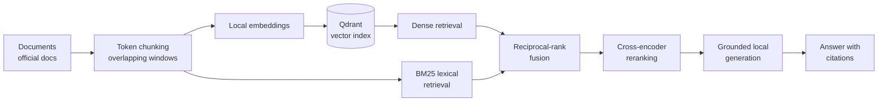

# Wayfinder RAG

**A retrieval-augmented generation pipeline for open-source software documentation, built so every stage can be measured.**

Wayfinder answers questions from a corpus of official project documentation. Its main goal is diagnostic: when an answer is wrong, the evaluation shows whether retrieval found the evidence or the generator failed to use it. Every stage is modular and can be swapped out and measured on its own.

> **Status:** experimental. The pipeline and evaluation harness work end to end. Results are from a small benchmark and should be read as an early signal.

---

## Table of contents

- [Pipeline](#pipeline)
- [Retrieval methods](#retrieval-methods)
- [Results](#results)
- [Evaluation](#evaluation)
- [Getting started](#getting-started)
- [Repository layout](#repository-layout)
- [Roadmap](#roadmap)

---

## Pipeline



Retrieval and generation are kept separate on purpose, so a failed answer can be traced to its cause.

## Retrieval methods

| Method | How it finds evidence |
|---|---|
| **Dense** | Embeds the question and returns the nearest chunks in Qdrant. Good at matching meaning. |
| **Lexical (BM25)** | Scores chunks by keyword overlap. Good at exact terms, names and identifiers. |
| **Hybrid** | Merges the dense and lexical rankings with reciprocal-rank fusion, so each list can correct the other. |
| **Hybrid + reranking** | Passes the top hybrid candidates through a cross-encoder that scores each question–chunk pair directly. |
| **Agentic** (experimental) | Lets the system decide whether to retrieve again with a refined query before answering. |

## Results

Measured on the project's first 14-question benchmark. The evaluation set has since grown to 22 questions in [`data/evaluation_cases.json`](data/evaluation_cases.json), so these numbers should be re-run before being quoted as current.

| Retriever | Hit@1 | MRR | Recall@5 |
|---|---:|---:|---:|
| Dense | 0.857 | 0.917 | 1.000 |
| Hybrid | 0.929 | 0.964 | 1.000 |
| **Hybrid + reranking** | **1.000** | **1.000** | **1.000** |

These are early results from a small, intentionally curated corpus. They are not a general claim about retrieval quality.

A static case-study page with the pipeline, these results and a browsable view of the evaluation questions is in [`site/`](site/). It can be hosted directly on GitHub Pages.

## Evaluation

**Retrieval** is scored with:
- **Recall@k:** how often a relevant chunk appears in the top k results
- **Hit@k:** how often at least one relevant chunk appears in the top k results
- **Mean reciprocal rank (MRR):** how high the first relevant chunk ranks, on average

**Answers** are checked for:
- expected factual phrases
- the presence of citations, where required
- refusal when no evidence is available

Evaluation labels point to the specific chunks that contain the supporting evidence. Chunk size, overlap, models and corpus are versioned in `data/`, because any change affects reproducibility.

## Getting started

The project uses local models and needs no paid LLM API. The integration tests need a Qdrant server.

**Requirements:** Python 3.13 and [uv](https://docs.astral.sh/uv/). Docker is needed for Qdrant.

```bash
docker compose up -d qdrant      # Qdrant on port 6333
uv sync
```

The first run downloads the embedding, reranking and generation models from Hugging Face, along with the chunking tokenizer. This needs internet access and can take a while.

**Run the tests**

```bash
uv run pytest -q
```

**Run the experiments**

```bash
uv run python scripts/run_baseline.py         # compare the retrieval methods
uv run python scripts/run_local_answer.py     # grounded answer demo
uv run python scripts/run_answer_eval.py      # answer evaluation
uv run python scripts/run_agentic_eval.py     # agentic retrieval evaluation
```

## Repository layout

```text
wayfinder-rag/
├── src/wayfinder/
│   ├── ingestion/       # document models and token chunking
│   ├── embeddings/      # local embedding models
│   ├── indexing/        # indexing into Qdrant
│   ├── retrieval/       # dense, lexical, hybrid, reranked and agentic retrieval
│   ├── generation/      # local grounded generation
│   ├── evaluation/      # retrieval and answer metrics
│   └── observability/   # tracing
├── scripts/             # experiments and corpus fetching
├── data/                # documents, evaluation cases and source manifest
├── site/                # static case-study page
├── tests/
└── docker-compose.yml   # Qdrant for local development
```

## Roadmap

- A larger documentation corpus
- More selective citations
- Cleaner generation configuration
- Latency measurements
